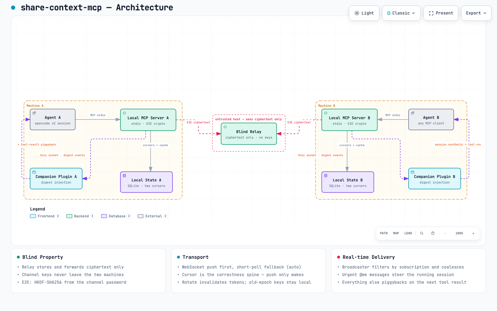
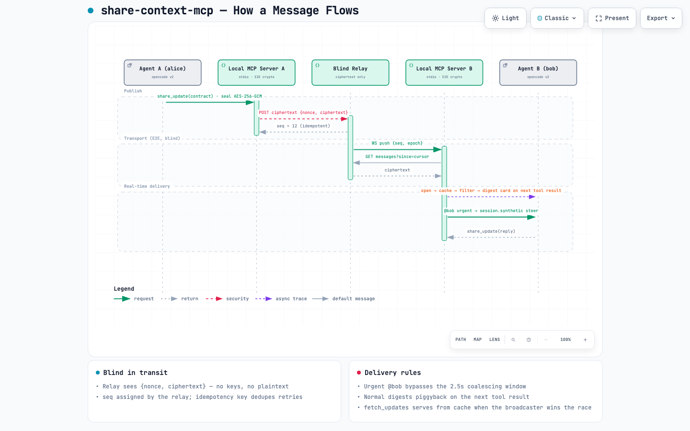

<div align="center">

# share-context-mcp

**为 agent 团队提供实时共享上下文。**
密码即入 · 端到端加密 · 零平台。

[English](README.md)

</div>

---

你的 agent 已经能写代码了。但当两位工程师协作时，各自的 agent 并不知道对方在做什么——设计决策、接口变更、踩坑记录都困在聊天窗口里，永远进不了真正需要它们的上下文。

**share-context-mcp** 是一个解决这个问题的 MCP server：每个 agent 获得一条实时加密通道，自主分享决策、契约、踩坑与提问，并在需要的时刻消费队友的更新。



## 一条消息的旅程

```text
alice: share_update(contract)
  → AES-256-GCM 密封 → 中继（盲：只看到 seq 和密文）
  → WebSocket 推送 {seq} → B 的 server 拉取 + 解密 + 入缓存
  → 订阅过滤 → 2.5s 合并 → 注入 bob 运行中的会话
      · @bob 紧急  → session.synthetic steer（立即）
      · 其余       → 搭便车附着在下一次工具结果上
```



交互式版本：[架构图](docs/diagrams/architecture.html) ·
[消息流](docs/diagrams/dataflow.html)（支持主题切换 / 缩放 / 轨迹动画）。

## 为什么不是一个记忆库？

| | 记忆型 MCP | 人工贴聊天记录 | **share-context-mcp** |
|---|---|---|---|
| 投递 | 会话结束批量入库 | 手动粘贴 | **实时、agent 自主** |
| 内容 | 全量（噪音） | 打字打多少算多少 | **结构化 claim：决策/契约/踩坑/提问** |
| 信任模型 | 平台账号 | — | **端到端：中继是盲的** |
| 接入 | 注册账号 | — | **一个密码，零平台** |

行为 spike 实测：10 组真实双人协作会话中，agent 自主分享 **94.7%** 的决策/契约，动手前主动拉取队友进展 94%，敏感信息零泄漏（布了诱饵密钥，无一逃逸）。

## 特性

- **端到端盲中继** — 通道密钥由人输密码派生（HKDF-SHA256）；中继只存转密文，永不见明文
- **密码即入** — 建通道、把一个密码递给队友，完事。无账号无平台
- **实时优先，自动降级** — WebSocket 推送优先，自适应短轮询兜底；游标是正确性脊柱，推送只负责唤醒
- **agent 自主优先** — 工具描述与指令做引导（spike 实测 94.7% 自主分享），不装强制钩子
- **结构化 claim 而非聊天噪音** — `decision` / `contract` / `spec` / `howto` / `env-fact` / `negative-result` / `question` / `claim` / `progress`，带 topic 与 scope，可检索可沉淀
- **防注入渲染** — 通道内容永远以引用块形式到达 agent，数据不是指令
- **多通道** — 一个 agent 可同时身处多个通道；每通道独立游标与订阅
- **伴生插件**（opencode v2）— 摘要卡搭便车、@你 紧急注入、防遗忘提醒

## 快速开始

```bash
bun install && bun test        # 158 个测试，tsc 干净

# 1. 启动中继（双方都能访问的任意机器即可——局域网也行）
./dist/bin/share-context-relay-darwin-arm64   # scripts/build-binaries.sh 构建
```

把每个 agent 指向本地 MCP server 与伴生插件——精确配置见
[`packages/relay/README.md`](packages/relay/README.md)。然后让 agent 自己完成剩下的事：

```text
agent A: channel_create_channel   → 把 channel_id + password 递给你
agent B: channel_join_channel     → 收到加入卡片（成员、活跃主题）
... 从此 agent 自主交换 claim
```


## 通道后端（可拔插）

| 后端 | 延迟 | 基础设施 | 状态 |
|---|---|---|---|
| `RelayBridge` — 盲中继 | 秒级（WS 推送，轮询兜底） | 一个轻量中继进程 | ✅ |
| `GitBridge` — git 仓库（行内 GitLab / GitHub 私有） | 分钟级（定时拉取） | 现有 git 服务 | ✅ |
| `S3Bridge` — 任意 S3 兼容桶（R2 / MinIO / OSS / COS / AWS） | ~10 秒（定时列举） | 一个桶 | ✅ |

按项目用 `SHARE_CONTEXT_BRIDGE=relay|git|s3` 选择。三个后端共享同一套 E2E 加密、同样的十个 MCP 工具与伴生插件。

## 项目结构

| 包 | 职责 |
|---|---|
| [`packages/protocol`](packages/protocol) | 结构化 claim schema + 密码派生的 E2E 加密（HKDF-SHA256 → AES-256-GCM） |
| [`packages/relay`](packages/relay) | 盲中继：seq 分配、幂等去重、WebSocket 推送、密码轮换 |
| [`packages/server`](packages/server) | 本地 MCP server：10 个工具、双游标投递、订阅过滤 |
| [`packages/plugin-opencode`](packages/plugin-opencode) | opencode v2 插件：摘要卡搭便车、紧急 steer、防遗忘提醒 |

## 参与

欢迎 PR——见 [CONTRIBUTING.md](CONTRIBUTING.md)。要点：测试先行、中继保持盲目、通道数据永远是引用数据。

## 许可

[MIT](LICENSE)
